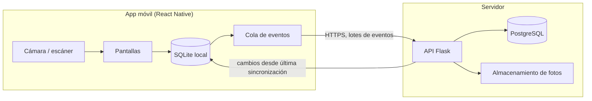

# 02. Arquitectura

## Vista general

## Componentes

**API (Flask).** Expone los endpoints REST, valida reglas de negocio y es la única fuente de verdad. Usa SQLAlchemy para el acceso a datos y Alembic para las migraciones.

**PostgreSQL.** Guarda todas las entidades y el historial. Cada fila tiene `tenant_id` para aislar los datos de cada clínica.

**Almacenamiento de fotos.** Las fotos se guardan fuera de la base de datos. En el MVP puede ser disco local con respaldo; luego se puede migrar a un servicio de objetos.

**App móvil (React Native con Expo).** Tiene una base SQLite local con las ubicaciones y los activos del tenant. Todas las acciones del usuario escriben primero en SQLite y después en la cola de eventos.

## Funcionamiento sin internet (local-first)

1. El usuario escanea un activo. La app busca el código en SQLite local.
2. Confirma la verificación. Se crea un evento `verificacion_registrada` con un UUID generado en el teléfono.
3. El evento se guarda en la cola local (`outbox`) con estado `pendiente`.
4. Cuando hay conexión, la app envía los eventos en lotes. El servidor los aplica en una transacción, de forma idempotente: si un evento ya existe, lo ignora.
5. El servidor responde con los cambios desde la última sincronización (`since`), y la app los aplica en SQLite.

### Principios

- **Los IDs son UUID generados en el cliente.** Así dos teléfonos no chocan al crear registros sin conexión.
- **Los conteos son eventos inmutables.** Dos personas que cuentan la misma sala generan dos verificaciones, no un conflicto.
- **Los cambios de datos del activo llevan versión.** Si dos teléfonos editan el mismo campo, gana el último cambio, se guarda el anterior en el historial y el activo queda marcado para revisión.
- **Las fotos se suben en diferido.** El evento de verificación no espera a la foto; la foto se sube cuando hay red.
- **Borrado lógico.** Nada se borra físicamente; se marca como `dado_de_baja` con evento.

## Autenticación

Tokens de acceso de corta duración con renovación. El teléfono guarda el token de renovación en almacenamiento seguro del dispositivo. Cada petición valida el tenant y el rol del usuario.

## Multi-tenant

Todas las tablas de negocio tienen `tenant_id`. Las consultas del backend filtran siempre por el tenant del usuario autenticado; esto se centraliza en un solo punto de la capa de datos para no depender de que cada endpoint lo recuerde.

## Riesgos conocidos

| Riesgo | Mitigación |
|---|---|
| Sincronización compleja | Empezar con eventos inmutables y lotes simples; no usar motor de sincronización en el MVP |
| Pérdida de datos en el teléfono antes de sincronizar | Cola persistente en SQLite; aviso visible de eventos pendientes |
| Etiquetas dañadas o sin código legible | Alta rápida por foto y búsqueda manual por nombre o serial |
| Precios inconsistentes en la importación | Pantalla de revisión; ningún precio se importa sin confirmación |
