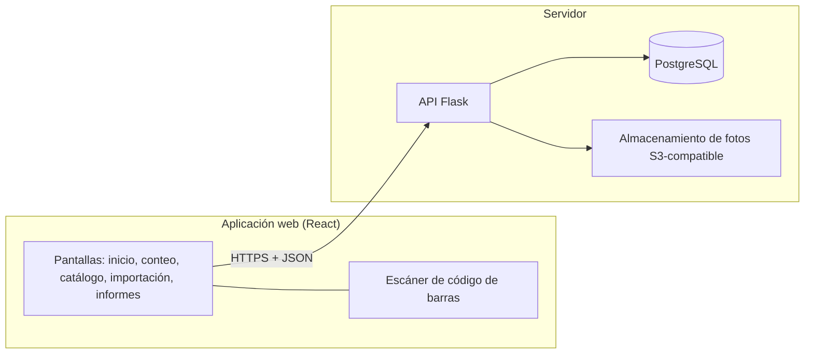

# 02. Arquitectura

## Vista general

Tres piezas: un cliente web, una API y una base de datos. Sin colas, sin servicios de sincronización, sin base local en el cliente.

## Componentes

**Aplicación web (`web/`).** React + TypeScript + Vite, Tailwind CSS y shadcn/ui, datos con TanStack Query. Una sola aplicación con dos modos de uso:

- *Conteo* (contador y admin): diseñada primero para teléfono. Escaneo por cámara, confirmación con un toque, alta por escaneo (ambos roles, sin revisión posterior del admin; P11, 2026-11-11).
- *Administración* (admin): Inicio (dashboard con indicadores, gráficas y evolución entre conteos), catálogo, importación del Excel, discrepancias, cierre de sesión e informes. Responsive (celular y computador). El contador tiene su propio Inicio en el modo conteo, sin ningún precio (P13; decisión del 2026-11-11).

**API (`backend/`).** Flask. Expone REST, valida reglas de negocio y es la única fuente de verdad. SQLAlchemy para datos y Alembic para migraciones. Publica un esquema OpenAPI del que se generan los tipos TypeScript del cliente.

**PostgreSQL.** Guarda todas las entidades y el historial. Cada fila de negocio tiene `tenant_id`. Se aloja en Supabase como PostgreSQL administrado (decisión 2026-11-11); Supabase es solo infraestructura: no se usa Supabase Auth ni su API REST automática, y Flask es el único acceso a los datos. Las pruebas corren contra un PostgreSQL local en Docker.

**Almacenamiento de fotos.** Supabase Storage (compatible con S3). La API recibe la foto, la guarda y registra su `storage_key`. Las fotos no viven en la base.

## Flujo de conteo

1. El contador abre la sesión de conteo y escanea el sticker de código de barras de un activo.
2. La app consulta el activo por `codigo` (el impreso en el sticker). Si existe, abre ese activo. Si no existe en el tenant, ofrece crear el activo con ese código (alta por escaneo: pocos campos, copiando un activo parecido). El sistema no genera códigos ni imprime etiquetas.
3. El contador confirma ubicación encontrada y estado físico. La app envía `POST /sesiones/{id}/verificaciones` con un UUID generado en el cliente.
4. El servidor guarda la verificación con una copia del precio y la categoría vigentes ([ADR-003](adr/ADR-003-verificacion-con-snapshot.md)) y responde.
5. Si la petición falla por red, la pantalla lo indica y ofrece **reintentar**. Como el UUID es la clave de idempotencia, reintentar nunca duplica.

Si la sesión ya está cerrada, la API responde `409 sesion_cerrada`.

## Principios

- **Los conteos son registros inmutables.** Dos personas que cuentan la misma sala generan dos verificaciones, no un conflicto. Para el informe cuenta la última por `(sesión, activo)`.
- **Un UUID por verificación** generado en el cliente: protege contra doble toque y reintentos.
- **Ediciones del activo con concurrencia optimista** (`row_version` + `If-Match`): si dos admins editan a la vez, el segundo recibe `412` y debe recargar.
- **Borrado lógico.** Nada se borra físicamente; se marca `dado_de_baja` con evento.
- **Reglas de negocio en `domain/`**, sin dependencia de Flask ni de la base. Los totales de un informe son lo más crítico y se prueban de forma aislada.
- **El cierre congela totales y desglose.** En una sola transacción, el cierre guarda las tres cifras en `sesion_conteo` y el desglose por categoría y por ubicación en `sesion_desglose` (R4, R9 de [03](03-modelo-datos.md); [ADR-003](adr/ADR-003-verificacion-con-snapshot.md)). El informe, la exportación y la evolución del Inicio leen lo congelado, no recalculan. El "valor actual" (R7) y los indicadores de trabajo del Inicio (avance, discrepancias, actividad) son consultas en tiempo real, rotuladas como tales y sin mezclarse con lo congelado.

## Autenticación y autorización

- Token de acceso de corta duración y *refresh token* en cookie `HttpOnly`, `Secure`, `SameSite=Lax`.
- Cada petición valida usuario, tenant y rol (`admin` | `contador`).
- **Visibilidad del precio por rol (P13, 2026-11-11):** solo el `admin` ve precios (`precio_compra`, `precio_al_contar`, eventos `precio_cambiado` y precios dentro de otros eventos). Las respuestas al `contador` no los serializan en ninguna ruta (ficha, historial, verificación, autocompletado); el filtrado de campos por rol vive en el servidor, no en la UI, y cada endpoint afectado trae su prueba. El contador solo escribe el precio al dar de alta.
- Invitaciones: enlace de un solo uso con expiración; se guarda solo su hash.

## Multi-tenant

Todas las tablas de negocio tienen `tenant_id`. Las consultas del backend se filtran por el tenant del usuario autenticado en **un solo punto** de la capa de datos, para no depender de que cada endpoint lo recuerde. La barrera la pone PostgreSQL con Row Level Security obligatoria y un rol de aplicación sin `BYPASSRLS` (2026-11-11, [ADR-001](adr/ADR-001-stack.md)). Cada endpoint tiene una prueba que verifica que no devuelve datos de otro tenant.

## Despliegue

Un contenedor para la API (que también sirve los estáticos de `web/` o los sirve un CDN); dónde se aloja el backend: `[PENDIENTE]` (T10 de [05](05-preguntas-abiertas.md)). Base de datos y fotos en Supabase. Dependencias de Python con uv. HTTPS obligatorio: sin él el navegador no entrega acceso a la cámara. Migraciones y despliegue desde GitHub Actions.

## Riesgos conocidos

| Riesgo | Mitigación |
|---|---|
| Escaneo por cámara del navegador menos fluido que una app nativa | Librería de lectura probada (ZXing), entrada manual del código y búsqueda por nombre/serial como respaldo |
| Los códigos de barras 1D se leen peor con cámara de teléfono que los QR (reflejos, curvatura, tamaño, poca luz) | Formato estándar legible por ZXing (p. ej. Code 128, pendiente en P9), buen tamaño y contraste, pruebas en teléfonos reales antes de comprar el lote completo, y entrada manual del código como respaldo |
| Corte de internet durante un conteo | La app avisa y permite reintentar; las verificaciones ya confirmadas están a salvo en el servidor. Si el piloto demuestra que no basta, se añade PWA con cola de reintentos |
| Stickers dañados o sin código legible | Entrada manual del código impreso y búsqueda por nombre/serial; reponer el sticker con el mismo código (el sistema no imprime etiquetas, se gestiona con el proveedor de stickers) |
| Precios inconsistentes en la importación | Pantalla de revisión; ningún precio se importa sin confirmación |
| Fuga de datos entre tenants | Filtro central + prueba por endpoint |
| Alta por el contador con precio mal digitado y sin revisión (P11): entra al valor total | El admin corrige el precio (`precio_cambiado` con antes/después; no altera sesiones cerradas, ADR-003) y el historial (visible al admin) muestra quién dio de alta. Con P13 el contador no ve su precio después y no puede verificarlo: la corrección depende del admin. Filtro de "altas recientes" para el admin: `[PENDIENTE]`, decide el humano |
| Uso de Supabase como infraestructura: exposición accidental de datos o fotos fuera de Flask | `[PENDIENTE]` revisión del `security-reviewer`: (1) el acceso a la base es solo desde el backend; (2) la API y las claves públicas de Supabase no se usan ni se exponen; (3) RLS es obligatoria (decidido 2026-11-11, [ADR-001](adr/ADR-001-stack.md)): toda tabla de negocio con `ENABLE` + `FORCE ROW LEVEL SECURITY` y política por `tenant_id`; Flask se conecta con un rol propio sin superusuario ni `BYPASSRLS`, distinto del que migra; (4) las fotos no son públicas (bucket privado). La configuración concreta no está decidida |
| Un campo de precio se filtra al contador por un endpoint olvidado | Filtrado por rol en el servidor (no en la UI) y prueba por endpoint de que la respuesta al contador no trae precios; revisión del `security-reviewer` |
