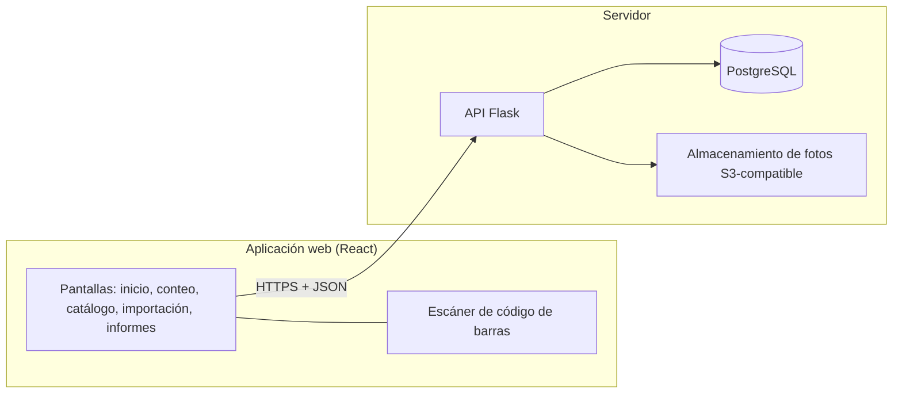

# 02. Arquitectura

## Vista general

Tres piezas: un cliente web, una API y una base de datos. Sin colas, sin servicios de sincronización, sin base local en el cliente.

## Componentes

**Aplicación web (`web/`).** React + TypeScript + Vite, Tailwind CSS y shadcn/ui, datos con TanStack Query. Una sola aplicación con dos modos de uso:

- *Conteo* (contador y admin): diseñada primero para teléfono. Escaneo por cámara, confirmación con un toque, alta por escaneo (ambos roles, sin revisión posterior del admin; P11, 2026-11-11).
- *Administración* (admin): Inicio (dashboard con indicadores, gráficas y evolución entre conteos), catálogo, importación del Excel, discrepancias, cierre de sesión e informes. Responsive (celular y computador). El contador tiene su propio Inicio en el modo conteo, sin ningún precio (P13; decisión del 2026-11-11).

**API (`backend/`).** Flask. Expone REST, valida reglas de negocio y es la única fuente de verdad. SQLAlchemy para datos y Alembic para migraciones. Publica un esquema OpenAPI del que se generan los tipos TypeScript del cliente.

**PostgreSQL.** Guarda todas las entidades y el historial. Cada fila de negocio tiene `tenant_id`. Se aloja en Supabase como PostgreSQL administrado (decisión 2026-11-11); Supabase es solo infraestructura: no se usa Supabase Auth ni su API REST automática, y Flask es el único acceso a los datos. Las pruebas corren contra un PostgreSQL local en Docker.

**Almacenamiento de fotos (spec 012).** Supabase Storage (compatible con S3) en producción, con un bucket privado y llaves que solo tiene Flask; en desarrollo y pruebas, una carpeta local (`backend/.almacen`). La API recibe la foto, la valida por su contenido, la vuelve a codificar en JPEG sin metadatos (sin GPS) con una miniatura, la guarda y registra su clave en `foto`. Las fotos no viven en la base y el navegador nunca recibe una URL del almacenamiento: las pide a `GET /api/fotos/{id}` con su sesión.

## Flujo de conteo

1. El contador abre la sesión de conteo y escanea el sticker de código de barras de un activo.
2. La app consulta el activo por `codigo` (el impreso en el sticker). Si existe, abre ese activo. Si no existe en el tenant, ofrece crear el activo con ese código (alta por escaneo: pocos campos, copiando un activo parecido). El sistema no genera códigos ni imprime etiquetas.
3. El contador confirma ubicación encontrada y estado físico. La app envía `POST /sesiones/{id}/verificaciones` con un UUID generado en el cliente.
4. El servidor guarda la verificación con una copia del precio y la categoría vigentes ([ADR-003](adr/ADR-003-verificacion-con-snapshot.md)) y responde.
5. Si la petición falla por red, la pantalla lo indica y ofrece **reintentar**. Como el UUID es la clave de idempotencia, reintentar nunca duplica.

Si la sesión ya está cerrada, la API responde `409 sesion_cerrada`.

## Principios

- **Los conteos son registros inmutables.** Dos personas que cuentan la misma sala generan dos verificaciones, no un conflicto. Para el informe cuenta la última por `(sesión, activo)`.
- **Un UUID por verificación** generado en el cliente: protege contra doble toque y reintentos.
- **Ediciones del activo con concurrencia optimista** (`row_version` + `If-Match`): si dos admins editan a la vez, el segundo recibe `412` y debe recargar.
- **Borrado lógico.** Nada se borra físicamente; se marca `dado_de_baja` con evento.
- **Reglas de negocio en `domain/`**, sin dependencia de Flask ni de la base. Los totales de un informe son lo más crítico y se prueban de forma aislada.
- **El cierre congela totales y desglose.** En una sola transacción, el cierre guarda las tres cifras en `sesion_conteo` y el desglose por categoría y por ubicación en `sesion_desglose` (R4, R9 de [03](03-modelo-datos.md); [ADR-003](adr/ADR-003-verificacion-con-snapshot.md)). El informe, la exportación y la evolución del Inicio leen lo congelado, no recalculan. El "valor actual" (R7) y los indicadores de trabajo del Inicio (avance, discrepancias, actividad) son consultas en tiempo real, rotuladas como tales y sin mezclarse con lo congelado.

## Autenticación y autorización

- Token de acceso de corta duración y *refresh token* en cookie `HttpOnly`, `Secure`, `SameSite=Lax`.
- Cada petición valida usuario, tenant y rol (`admin` | `contador`).
- **Visibilidad del precio por rol (P13, 2026-11-11):** solo el `admin` ve precios (`precio_compra`, `precio_al_contar`, eventos `precio_cambiado` y precios dentro de otros eventos). Las respuestas al `contador` no los serializan en ninguna ruta (ficha, historial, verificación, autocompletado); el filtrado de campos por rol vive en el servidor, no en la UI, y cada endpoint afectado trae su prueba. El contador solo escribe el precio al dar de alta.
- Invitaciones: enlace de un solo uso con expiración; se guarda solo su hash.
- **Segunda identidad: el desarrollador (spec 017).** La consola `/plataforma` usa una identidad distinta de la del tenant, en la tabla `desarrollador` (no es un rol de tenant). Su token de acceso no lleva `tenant`, tiene `typ=plataforma`, usa una clave derivada con contexto propio y dura 10 minutos; el refresh va en una cookie propia (`__Secure-plat-refresh`, `HttpOnly`, `SameSite=Lax`, `Path` del prefijo `/plataforma/auth`, 8 h, rotación y familia revocable) con CSRF `X-AssetControl-CSRF: 1`. Un token de plataforma recibe `401` en todo endpoint de tenant y uno de tenant recibe `401` en todo `/plataforma/*` (prueba que recorre `url_map`). Las respuestas de `/plataforma` llevan `Cache-Control: no-store` y `Referrer-Policy: no-referrer`; un desarrollador desactivado pierde el acceso en su siguiente petición aunque su token siga vigente. Con `PLATAFORMA_HABILITADA` distinto de `true` no se registra ninguna ruta `/plataforma` (responde `404`) y no se crea ningún dato; `PLATAFORMA_REDES_PERMITIDAS` es una defensa adicional (la restricción real va en el proxy o el firewall). La cuenta de desarrollador la crea el operador por CLI con el rol migrador (ver [09](09-despliegue.md)).
- **Único camino multi-tenant: funciones `acceso.plataforma_*`.** El rol de aplicación sigue sin `BYPASSRLS`. La consola opera sobre varias empresas solo con funciones `SECURITY DEFINER` acotadas del esquema `acceso`, de dueño `plataforma_owner` (rol `NOLOGIN`, inerte, distinto de `auth_owner`), que comprueban primero que el desarrollador esté activo, devuelven solo identidad de empresa y de usuarios (nunca precios, datos de negocio, contraseñas ni hashes) y vacían las GUC `app.plat_*` al entrar y al salir. Existen: `plataforma_buscar_login`, `plataforma_listar_tenants`, `plataforma_crear_tenant`, `plataforma_cambiar_estado_tenant` (Empresas), `plataforma_listar_usuarios`, `plataforma_cambiar_estado_membresia` (Usuarios), `plataforma_listar_auditoria` (Actividad), `plataforma_registrar_logo` (logo del alta o reemplazo del vigente; desde el cambio C1 ya no responde `logo_existente`), y, del cambio C1 (migraciones `0030` y `0031`), `plataforma_leer_empresa` y `plataforma_actualizar_empresa` (leer y editar la ficha de `empresa`: nombre, dirección, NIT, teléfono y correo; al cambiar el nombre también actualiza `tenant.nombre`, nunca `activo` ni `desactivado_*`) y `plataforma_cambiar_usuario` (nombre de `usuario` y rol de esa `membresia`, con el mismo candado y la misma regla de `409 ultimo_admin` que `plataforma_cambiar_estado_membresia`; si cambia el rol revoca los refresh de esa membresía; nunca toca `email`, `password_hash` ni `activo`), y, del cambio C1b (migración `0032`), `plataforma_restablecer_password_usuario` (`void`: con el mismo candado por empresa, tomado en cada empresa del usuario en orden, escribe solo `usuario.password_hash` —hash Argon2id calculado en Flask; la función valida su formato—, `debe_cambiar_password = true` y `sesiones_validas_desde = now()`, y revoca todas las familias de refresh del usuario; nunca lee ni devuelve un hash; es la segunda vía que escribe `password_hash` además de `auth_owner`); y, solo para el operador (rol migrador), `crear_desarrollador`, `restablecer_desarrollador` y `cambiar_estado_desarrollador`. La sesión de plataforma (`plataforma_session`) no lee tablas de negocio y la del tenant no lee las de plataforma. Toda acción de la consola se audita en `plataforma_auditoria` (solo `INSERT`; lista cerrada de acciones, sin datos personales ni contraseñas; C1 suma `empresa_editada`, `empresa_logo_reemplazado` y `usuario_editado`, que se escriben solo si algo cambió y nunca guardan los valores; C1b suma `usuario_contrasena_restablecida`, que se escribe en cada definición —no es idempotente— con el usuario como `objeto_id` y sin la contraseña ni el hash). Rutas de C1: `GET`/`PUT /plataforma/empresas/{id}/ficha`, `POST /plataforma/empresas/{id}/logo` (también reemplaza) y `PUT /plataforma/empresas/{id}/usuarios/{usuario_id}` (exactamente `{nombre, rol}`; el `PATCH` de la misma ruta sigue siendo solo para activar o desactivar); los `PUT` y el `POST` cuentan en `plat_accion`. Ruta de C1b: `POST /plataforma/empresas/{id}/usuarios/{usuario_id}/contrasena` (exactamente `{password, password_confirmacion}`, misma política que el alta, `204` sin cuerpo, `no-store`, cuenta en `plat_accion`; la web no la guarda en estado, caché, almacenamiento ni URL y no la reintenta sola). Decisión pendiente de formalizar: ADR-005 «Identidad de plataforma y acceso multi-tenant por funciones acotadas» (lo decide el humano).
- **Empresa desactivada.** `tenant.activo = false` corta el acceso: `acceso.buscar_login` no devuelve membresías de un tenant inactivo, `load_current_user` y el refresh rechazan con `401`, y las invitaciones de ese tenant dejan de ser válidas (sin consumirse) hasta reactivarlo. Desactivar una membresía (módulo Usuarios) revoca sus refresh y se serializa con un candado consultivo por empresa compartido con login, refresh, aceptar invitación y cambio de contraseña (`503` con `Retry-After` si el candado no llega en ~3 s; ese plazo es `LOCK_TIMEOUT_MEMBRESIAS` del lado Flask, en `backend/app/auth/service.py`, mientras que las funciones SQL de las migraciones 0027 y 0029 fijan su propio `lock_timeout` de 5 s).
- **Cambio obligatorio de contraseña.** Si `usuario.debe_cambiar_password` es `true`, el decorador común de endpoints de tenant responde `403 cambio_password_requerido` antes de verificar el rol, salvo una lista blanca por endpoint (`auth.me` y `auth.cambiar_contrasena`); `POST /auth/cambiar-contrasena` cambia la contraseña, quita la marca, revoca las demás familias de refresh y responde una sesión nueva. Cambiar o restablecer la contraseña fija `usuario.sesiones_validas_desde = now()` y `load_current_user` rechaza con `401` el access token con `iat` anterior a ese corte (el JWT de 15 min ya emitido deja de valer). Supone los relojes de Flask y PostgreSQL sincronizados (NTP).

## Multi-tenant

Todas las tablas de negocio tienen `tenant_id`. Las consultas del backend se filtran por el tenant del usuario autenticado en **un solo punto** de la capa de datos, para no depender de que cada endpoint lo recuerde. La barrera la pone PostgreSQL con Row Level Security obligatoria y un rol de aplicación sin `BYPASSRLS` (2026-11-11, [ADR-001](adr/ADR-001-stack.md)). Cada endpoint tiene una prueba que verifica que no devuelve datos de otro tenant. Excepciones cerradas (spec 017): `desarrollador`, `plataforma_refresh_token` y `plataforma_auditoria` no son tablas de negocio de un tenant y no llevan `tenant_id` como filtro (la auditoría lo guarda como dato opcional); su aislamiento lo hace cumplir RLS por desarrollador activo y el catálogo de RLS las prueba aparte. La consola nunca lee datos de negocio.

## Despliegue

Un solo contenedor (`Dockerfile.prod`, spec 010b): gunicorn sirve la web compilada en `/` y la API bajo `/api`, en el mismo origen. Dónde se aloja: `[PENDIENTE]` (T10 de [05](05-preguntas-abiertas.md)); la guía para cualquier plataforma está en [09](09-despliegue.md). Base de datos y fotos en Supabase. Dependencias de Python con uv. HTTPS obligatorio: sin él el navegador no entrega acceso a la cámara. Migraciones y despliegue desde GitHub Actions. **Consola de plataforma (spec 017):** `PLATAFORMA_HABILITADA` (apagada por defecto) y `PLATAFORMA_REDES_PERMITIDAS` se configuran por entorno; la exposición de `/plataforma` en el mismo contenedor y dominio es un riesgo documentado en [09](09-despliegue.md) y se cierra con la spec de despliegue (P33, R1 de la 017).

## Riesgos conocidos

| Riesgo | Mitigación |
|---|---|
| Escaneo por cámara del navegador menos fluido que una app nativa | Librería de lectura probada (ZXing), entrada manual del código y búsqueda por nombre/serial como respaldo |
| Los códigos de barras 1D se leen peor con cámara de teléfono que los QR (reflejos, curvatura, tamaño, poca luz) | Formato estándar legible por ZXing (p. ej. Code 128, pendiente en P9), buen tamaño y contraste, pruebas en teléfonos reales antes de comprar el lote completo, y entrada manual del código como respaldo |
| Corte de internet durante un conteo | La app avisa y permite reintentar; las verificaciones ya confirmadas están a salvo en el servidor. Si el piloto demuestra que no basta, se añade PWA con cola de reintentos |
| Stickers dañados o sin código legible | Entrada manual del código impreso y búsqueda por nombre/serial; reponer el sticker con el mismo código (el sistema no imprime etiquetas, se gestiona con el proveedor de stickers) |
| Precios inconsistentes en la importación | Pantalla de revisión; ningún precio se importa sin confirmación |
| Fuga de datos entre tenants | Filtro central + prueba por endpoint |
| Alta por el contador con precio mal digitado y sin revisión (P11): entra al valor total | El admin corrige el precio (`precio_cambiado` con antes/después; no altera sesiones cerradas, ADR-003) y el historial (visible al admin) muestra quién dio de alta. Con P13 el contador no ve su precio después y no puede verificarlo: la corrección depende del admin. Filtro de "altas recientes" para el admin: `[PENDIENTE]`, decide el humano |
| Uso de Supabase como infraestructura: exposición accidental de datos o fotos fuera de Flask | `[PENDIENTE]` revisión del `security-reviewer`: (1) el acceso a la base es solo desde el backend; (2) la API y las claves públicas de Supabase no se usan ni se exponen; (3) RLS es obligatoria (decidido 2026-11-11, [ADR-001](adr/ADR-001-stack.md)): toda tabla de negocio con `ENABLE` + `FORCE ROW LEVEL SECURITY` y política por `tenant_id`; Flask se conecta con un rol propio sin superusuario ni `BYPASSRLS`, distinto del que migra; (4) las fotos no son públicas (bucket privado). La configuración concreta no está decidida |
| Un campo de precio se filtra al contador por un endpoint olvidado | Filtrado por rol en el servidor (no en la UI) y prueba por endpoint de que la respuesta al contador no trae precios; revisión del `security-reviewer` |
