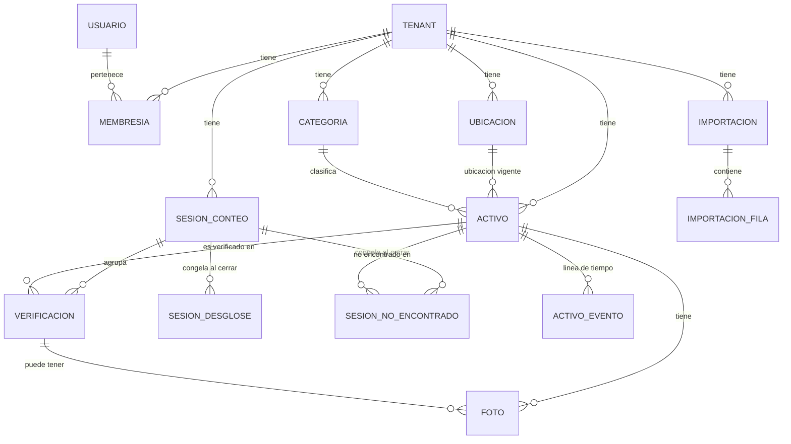

# 03. Modelo de datos

> **Estado: propuesta.** Las marcas `[PENDIENTE]` dependen de preguntas abiertas (ver [05-preguntas-abiertas.md](05-preguntas-abiertas.md)).

## Principios

- PostgreSQL. Todas las tablas de negocio llevan `tenant_id`.
- Claves primarias `uuid`. Las entidades creadas desde el cliente (`verificacion`, `activo` de alta por escaneo, `foto`) usan un UUID generado en el cliente: así reintentar una petición no duplica.
- Dinero siempre `NUMERIC(14,2)`, moneda `COP`. Nunca `float`.
- Nada se borra físicamente: bajas con estado y evento.
- Las verificaciones y los eventos de historial son **inmutables** (solo `INSERT`).
- `seq` es un `bigint` generado por secuencia en el servidor. Sirve para ordenar de forma estable. No se usan timestamps del cliente para ordenar.

## Diagrama

## Entidades

### Identidad y acceso

| Tabla | Campos principales | Notas |
|---|---|---|
| `tenant` | `id`, `nombre`, `creado_en` | Se crea por script/CLI, sin pantalla de alta. |
| `usuario` | `id`, `email` (único), `nombre`, `password_hash`, `activo` | Global, no pertenece a un tenant. |
| `membresia` | `id`, `tenant_id`, `usuario_id`, `rol` (`admin`\|`contador`), `activa` | Único `(tenant_id, usuario_id)`. El token de acceso lleva un solo tenant. |
| `invitacion` | `id`, `tenant_id`, `rol`, `token_hash`, `expira_en`, `usada_en`, `creada_por` | Enlace de un solo uso. Se guarda el hash, nunca el token. |

### Catálogo

| Tabla | Campos principales | Notas |
|---|---|---|
| `ubicacion` | `id`, `tenant_id`, `nombre`, `tipo` (`sede`\|`sala`\|`box`), `padre_id`, `activa` | Jerarquía simple por `padre_id`. |
| `categoria` | `id`, `tenant_id`, `nombre` | Lista cerrada. Resuelve "Mobiliaria/Mobiliario/Inmobiliaria" del Excel. |
| `activo` | ver abajo | Entidad central. |

`activo`:

| Campo | Tipo | Notas |
|---|---|---|
| `id` | uuid | Generado en cliente si es alta por escaneo. |
| `tenant_id` | uuid | |
| `codigo` | text | **Obligatorio**, único por tenant e **inmutable** tras el alta. Es el código impreso en el sticker de código de barras pegado al activo; el sistema no lo genera. Un duplicado se rechaza. Una fila = una unidad física. |
| `nombre` | text | |
| `categoria_id` | uuid NOT NULL | FK a `categoria`. Categoría **vigente**. |
| `ubicacion_id` | uuid NOT NULL | FK a `ubicacion`. Ubicación **vigente**. Un activo tiene una sola. |
| `serial`, `marca`, `modelo`, `referencia`, `color` | text null | `serial` es el del fabricante, **opcional y no único**: el Excel repite seriales en distintas ubicaciones y es válido. Solo índice; nunca se usa para fusionar ni deduplicar. |
| `subtipo` | text null | Ej. Video, Computador, Fuente. Texto libre con autocompletado; la categoría es la lista cerrada. |
| `atributos` | jsonb | Campos propios de una categoría (ej. `lote`, `registro_sanitario` en biomédicos). |
| `precio_compra` | numeric(14,2) NOT NULL | Precio de compra, según el alcance. **Obligatorio en el alta** (P13, 2026-11-11). **Visibilidad:** solo el `admin` lo ve; el `contador` lo escribe al dar de alta y la API no se lo devuelve después. Lo mismo aplica a `precio_al_contar` y a los eventos `precio_cambiado`. El filtrado es del servidor. |
| `fecha_compra` | date null | Propuesto, ver pregunta P7. |
| `estado` | enum | `activo`, `en_reparacion`, `dado_de_baja`. |
| `row_version` | int | Concurrencia optimista en ediciones **online** (`If-Match`). |
| `creado_por`, `creado_en`, `actualizado_en` | | |

Se eliminó el campo `requiere_revision` (decisión del humano, 2026-11-11): no tiene uso, porque el alta no se revisa (P11) y el precio es obligatorio (P13), y aún no existen migraciones.

### Conteo e historial

`sesion_conteo`:

| Campo | Notas |
|---|---|
| `id`, `tenant_id`, `nombre` | |
| `tipo` | `conteo` \| `importacion`. La importación crea una sesión baseline que **no** cuenta como conteo real. |
| `estado` | `abierta` \| `cerrada`. Una vez `cerrada` no se modifica nada asociado. |
| `abierta_por`, `abierta_en`, `cerrada_por`, `cerrada_en` | |
| `fecha_corte` | Fecha a la que se refiere el informe. |
| `total_encontrado`, `total_no_encontrado`, `total_registrado` | numeric(14,2). **Se congelan al cerrar.** Son la suma de las filas del desglose de una dimensión (regla R4). El desglose por categoría y por ubicación se congela en `sesion_desglose` (R9) y la lista por activo de los no encontrados en `sesion_no_encontrado` (R9a). |

`sesion_desglose` (**propuesta**, decisión del humano del 2026-11-11; inmutable, solo `INSERT`; la escribe solo el servidor en la misma transacción del cierre):

| Campo | Tipo | Notas |
|---|---|---|
| `id` | uuid | Lo genera el servidor (no hay escritura desde el cliente). |
| `tenant_id` | uuid | Como toda tabla de negocio (R1). |
| `sesion_id` | uuid | Sesión `cerrada` a la que pertenece. |
| `dimension` | enum | `categoria` \| `ubicacion`. |
| `categoria_id` | uuid null | FK a `categoria`. Lleno si `dimension=categoria`; nulo en otro caso. Qué categoría se usa: la del criterio de R4 (P21, decidida el 2026-11-11). |
| `ubicacion_id` | uuid null | FK a `ubicacion`. Lleno si `dimension=ubicacion`; nulo en otro caso. Es exactamente la ubicación del criterio de R4 (el nodo de la jerarquía al que apunta el activo o la verificación) (P20, decidida el 2026-11-11); no se agrega por sede ni por sala. |
| `total_encontrado`, `total_no_encontrado`, `total_registrado` | numeric(14,2) | COP. Suma de los precios de los activos de U (R4) que caen en la fila. |
| `unidades_encontrado`, `unidades_no_encontrado`, `unidades_registrado` | integer | Una unidad = un `activo` (R8). |
| `creado_en` | timestamptz | Igual a `cerrada_en` de la sesión. |

Restricciones propuestas:

- Índice único parcial `(sesion_id, categoria_id) WHERE dimension = 'categoria'`.
- Índice único parcial `(sesion_id, ubicacion_id) WHERE dimension = 'ubicacion'`.
- `CHECK`: si `dimension = 'categoria'`, `categoria_id IS NOT NULL AND ubicacion_id IS NULL`; si `dimension = 'ubicacion'`, `ubicacion_id IS NOT NULL AND categoria_id IS NULL`.
- Motivo: en PostgreSQL los `NULL` son distintos entre sí, así que un único `(sesion_id, dimension, categoria_id, ubicacion_id)` no detectaría filas duplicadas.

Solo hay fila para categorías y ubicaciones con al menos un activo del universo de cierre U (R4). Los subtotales por jerarquía (sede, sala) son una vista que suma filas de ubicación; no se guardan. `sesion_conteo` no tiene columnas de unidades: las unidades totales de la sesión se leen como la suma de una dimensión del desglose, que también está congelada. Un nombre de categoría o ubicación cambiado después no altera las cifras; el rótulo que se muestra es el vigente `[PENDIENTE: si hace falta congelar también el nombre, se decide en la spec 008]`.

`sesion_no_encontrado` (**propuesta**, decisión del humano E1 del 2026-11-11; inmutable, solo `INSERT`; la escribe solo el servidor en la misma función y transacción del cierre, R4, R8 y R9a):

| Campo | Tipo | Notas |
|---|---|---|
| `id` | uuid | Lo genera el servidor (no hay escritura desde el cliente). |
| `tenant_id` | uuid NOT NULL | Como toda tabla de negocio (R1). |
| `sesion_id` | uuid NOT NULL | FK a `sesion_conteo`. Sesión `cerrada` a la que pertenece. |
| `activo_id` | uuid NOT NULL | FK a `activo`. Activo de U sin verificación en la sesión (no encontrado, R4). |
| `codigo` | text NOT NULL | Copia de `activo.codigo` al cierre. |
| `nombre` | text NOT NULL | Copia de `activo.nombre` al cierre. Un cambio de nombre posterior no altera la lista. |
| `categoria_id` | uuid NOT NULL | FK a `categoria`. `activo.categoria_id` vigente al cierre (criterio de R4, D1/P21). |
| `ubicacion_id` | uuid NOT NULL | FK a `ubicacion`. `activo.ubicacion_id` vigente al cierre (criterio de R4, D1/P20). |
| `precio` | numeric(14,2) NOT NULL | COP. `activo.precio_compra` vigente al cierre. Solo lo ve el `admin` (P13). |
| `en_reparacion` | boolean NOT NULL | `true` si el activo tenía estado `en_reparacion` al cierre. Es la marca "en reparación" que muestran el informe, la exportación y el Inicio. |
| `creado_en` | timestamptz | Igual a `cerrada_en` de la sesión. |

Restricciones propuestas:

- Índice único `(sesion_id, activo_id)`: un activo aparece como mucho una vez por sesión.
- Solo hay filas de sesiones `cerrada` de tipo `conteo`.

`verificacion` (inmutable, unidad de sincronización):

| Campo | Notas |
|---|---|
| `id` | UUID del cliente. Es la clave de idempotencia. |
| `tenant_id`, `sesion_id`, `activo_id` | |
| `ubicacion_esperada_id` | uuid NOT NULL, FK a `ubicacion`. La que tenía el activo al contar (copia de `activo.ubicacion_id`). Es la que usa el desglose por ubicación para lo encontrado (R4, P20). |
| `ubicacion_encontrada_id` | Donde se vio realmente. Si difiere, es una **observación**, no un cambio. |
| `estado_fisico` | `ok` \| `danado` (lista corta, `[PENDIENTE]` con la clínica). |
| `precio_al_contar` | numeric(14,2) NOT NULL. **Copia** de `activo.precio_compra` vigente al contar. Hace reproducible el informe. |
| `categoria_al_contar` | uuid NOT NULL, FK a `categoria` (el id, no el nombre). **Copia** de `activo.categoria_id` vigente al contar. |
| `nota` | |
| `verificado_por` | |
| `ocurrido_en` | Reloj del cliente, solo informativo. |
| `recibido_en`, `seq` | Los pone el servidor. |

`activo_evento` (línea de tiempo, la escribe solo el servidor):

| Campo | Notas |
|---|---|
| `id`, `tenant_id`, `activo_id` | |
| `tipo` | `creado`, `importado`, `verificado`, `ubicacion_cambiada`, `precio_cambiado`, `estado_cambiado`, `categoria_cambiada`, `dado_de_baja`. |
| `datos` (jsonb) | `{antes, despues}` para cambios. |
| `usuario_id`, `sesion_id` null, `verificacion_id` null | |
| `ocurrido_en`, `seq` | |

`foto`: `id` (UUID cliente), `tenant_id`, `activo_id`, `verificacion_id` null, `storage_key`, `estado` (`pendiente`\|`subida`), `subida_por`, `creada_en`. Los bytes viven en almacenamiento de objetos, no en la base.

### Importación (opcional)

- `importacion`: `id`, `tenant_id`, `archivo_nombre`, `estado` (`en_revision`\|`confirmada`\|`cancelada`), `creada_por`.
- `importacion_fila`: `id`, `importacion_id`, `hoja`, `fila`, `datos` (jsonb crudo), `resultado` (`nueva`\|`duplicado_probable`\|`dudosa`\|`descartada`), `motivo`, `decision` (`importar`\|`omitir`\|`fusionar`), `activo_id`.

Las filas crudas se conservan: son la evidencia de qué se importó y por qué.

## Reglas e invariantes

- **R1. Aislamiento.** Toda consulta se filtra por `tenant_id` en un único punto de la capa de datos.
- **R2. Idempotencia.** Reenviar una `verificacion` o un alta por escaneo con el mismo `id` no duplica ni falla: devuelve el registro ya guardado.
- **R3. Última verificación gana.** Para el informe, se usa una verificación por `(sesion, activo)`: la de mayor `seq`. Las demás se conservan en el historial.
- **R4. Cierre.** Cerrar una sesión calcula y guarda los tres totales a partir de las verificaciones R3 y de `precio_al_contar` (decisiones del humano del 2026-11-11: P15, P20, P21 y activos dados de baja).
  - **Universo del cierre U** = {activos con verificación R3 en la sesión, cualquiera sea su estado al cierre} ∪ {activos con estado `activo` o `en_reparacion` al cierre y sin verificación en la sesión}. Los `dado_de_baja` sin verificación en la sesión quedan fuera. Cada activo de U cae en exactamente una fila por dimensión del desglose (R9).
  - **Encontrado** (activo de U con verificación R3): precio = `precio_al_contar`, categoría = `categoria_al_contar` y ubicación = `ubicacion_esperada_id`, todos de esa verificación (foto al contar, ADR-003). Si después se dio de baja en la misma sesión, sigue siendo encontrado.
  - **No encontrado** (activo de U sin verificación): precio = `activo.precio_compra`, categoría = `activo.categoria_id` y ubicación = `activo.ubicacion_id`, vigentes al cierre. Un activo `en_reparacion` sin verificación va aquí, y el informe muestra la marca "en reparación" para no confundirlo con un faltante. La marca se congela al cierre en `sesion_no_encontrado.en_reparacion`, junto con la lista por activo de los no encontrados (R9a, decisión E1 del 2026-11-11).
  - Una discrepancia aplicada o un movimiento durante la sesión abierta no mueve lo ya contado: lo encontrado se ubica por `ubicacion_esperada_id` de su verificación. Lo mismo vale para un cambio de precio o de categoría posterior a la verificación.
  - **Un solo cálculo (R8).** Una sola función de dominio del servidor calcula **una vez** la lista de activos de U con su condición (encontrado / no encontrado), precio, categoría y ubicación según los puntos anteriores. De esa lista salen las filas del desglose (R9) y las filas de la lista de no encontrados (R9a), y `total_encontrado`, `total_no_encontrado` y `total_registrado` de `sesion_conteo` son la suma de esas filas (`total_registrado` = encontrado + no encontrado). Ningún otro código vuelve a calcular U ni los totales.
  - **Vista consistente y concurrencia.** El cierre bloquea la fila de `sesion_conteo` y lee U con una vista consistente de los datos (por ejemplo, aislamiento `REPEATABLE READ` o una sola consulta). Cubre toda escritura concurrente que pueda cambiar U o sus valores, no solo las verificaciones: alta de un activo, cambio de precio, de categoría o de ubicación, cambio de estado y baja. Cada una queda entera dentro de la vista del cierre o entera fuera; nunca a medias. Una verificación que llega después del cierre recibe `409 sesion_cerrada` (R5). El mecanismo exacto lo fija la spec 008; la regla es esta.
  - En la misma transacción guarda el desglose congelado (R9) y la lista congelada de no encontrados (R9a). Cierre repetido de una sesión ya cerrada: `[PENDIENTE]` (¿devuelve el informe o `409`?); en ningún caso se vuelven a insertar el desglose ni la lista.
- **R5. Sesión cerrada es inmutable.** Una verificación que llega para una sesión cerrada se rechaza con motivo `sesion_cerrada`.
- **R5a. Activo dado de baja no se verifica** (decisión del humano, 2026-11-11). El servidor rechaza una verificación de un activo con estado `dado_de_baja`; la app lo muestra como dado de baja. Una verificación guardada antes de la baja se conserva y, en esa sesión, el activo cuenta como encontrado (R4).
- **R6. Discrepancias.** Verificación con `ubicacion_encontrada_id ≠ ubicacion_esperada_id` aparece en la lista de discrepancias; el admin la aplica y eso genera `ubicacion_cambiada`.
- **R7. Valor en tiempo real.** Es una consulta sobre `activo` vigente, distinta del informe de sesión. No se mezclan. Cuentan los activos con estado `activo` o `en_reparacion`; los `dado_de_baja` no (P15, decisión E2 del 2026-11-11; mismo criterio de estado que la parte sin verificación del universo del cierre, R4). Aplica al valor en tiempo real, a "Activos hoy", a la tarjeta "Valor actual" y a las gráficas de "valor actual" del Inicio. El Inicio puede mostrar aparte cuántos de ellos están `en_reparacion`.
- **R8. Una fila por unidad y código del sticker.** No existe `cantidad` ni lote. Todo total es la suma de precios por unidad, calculada en un solo lugar del servidor. El `codigo` (el del sticker) es obligatorio, único por tenant e inmutable; no hay activos sin sticker.
- **R9. Desglose congelado al cierre** (decisión del humano, 2026-11-11). En la misma transacción del cierre (R4) el servidor inserta en `sesion_desglose` una fila por categoría y una por ubicación, con encontrado, no encontrado y total registrado en COP y en unidades. Las filas salen de la misma lista de activos de U que calcula R4 (mismo universo, mismos precios, misma categoría y misma ubicación por activo); R9 no tiene un cálculo propio. Motivo: lo "no encontrado" no tiene verificación que congele su precio, categoría ni ubicación; recalcularlo después cambiaría el informe si se corrige un precio o una categoría, se mueve o se da de baja un activo (rompería ADR-003). Reglas:
  - Las filas son inmutables (solo `INSERT`) y llevan `tenant_id`.
  - Cada activo de U (R4) cae en exactamente una fila de cada dimensión: la de su categoría y la de su ubicación según el criterio de R4 (encontrado: `categoria_al_contar` y `ubicacion_esperada_id` de su verificación R3; no encontrado: `activo.categoria_id` y `activo.ubicacion_id` vigentes al cierre).
  - La fila de ubicación usa exactamente esa ubicación, sin agregar por sede ni por sala. Los subtotales por jerarquía son una vista que suma filas; no se guardan.
  - Para cada dimensión, la suma de `total_encontrado`, `total_no_encontrado` y `total_registrado` de sus filas es igual a las tres cifras congeladas de la sesión, con cero diferencias; las unidades suman lo mismo en las dos dimensiones. Una prueba lo verifica.
  - El informe de sesión, su exportación y la evolución entre conteos **leen** estas filas; no recalculan el desglose.
  - Solo hay desglose de sesiones `cerrada` de tipo `conteo`; la sesión `importacion` no entra en la evolución.
  - P20 y P21 decididas (2026-11-11, ver [05, sección D](05-preguntas-abiertas.md#d-preguntas-surgidas-de-los-casos-de-uso)): criterio simétrico. Lo encontrado usa la foto al contar de su verificación R3 (`categoria_al_contar`, `ubicacion_esperada_id`), igual que el precio (ADR-003); lo no encontrado usa `activo.categoria_id` y `activo.ubicacion_id` vigentes al cierre. La ubicación encontrada no se usa en el desglose (no existe para lo no encontrado).
- **R9a. Lista de no encontrados congelada al cierre** (decisión del humano E1, 2026-11-11). En la misma función de dominio y la misma transacción del cierre (R4, R8), el servidor inserta en `sesion_no_encontrado` una fila por cada activo no encontrado de U, a partir de la misma lista U que usa R9: mismo precio (`activo.precio_compra` vigente al cierre), misma categoría y misma ubicación (vigentes al cierre, D1), más `codigo`, `nombre` y la marca `en_reparacion` copiados al cierre. R9a no tiene un cálculo propio. Motivo: lo no encontrado no tiene verificación que congele qué activos eran ni su estado; reconstruir la lista o la marca después cambiaría el informe si un activo se repara, se edita, se mueve o se da de baja (rompería ADR-003). Reglas:
  - Las filas son inmutables (solo `INSERT`), llevan `tenant_id` y son únicas por `(sesion_id, activo_id)`.
  - Cuadre (pruebas obligatorias, cero diferencias): la suma de `precio` de la lista = `total_no_encontrado` de la sesión; el número de filas = las unidades no encontradas; por cada categoría y por cada ubicación, la suma de `precio` y el número de filas de la lista coinciden con `total_no_encontrado` y `unidades_no_encontrado` de la fila correspondiente de `sesion_desglose`.
  - El informe de sesión, su exportación y el Inicio **leen** la lista y la marca "en reparación" de esta tabla; nada se reconstruye después a partir de `activo`.
  - Visibilidad (P13): la lista contiene precios; solo el `admin` la ve y el filtrado es del servidor.
