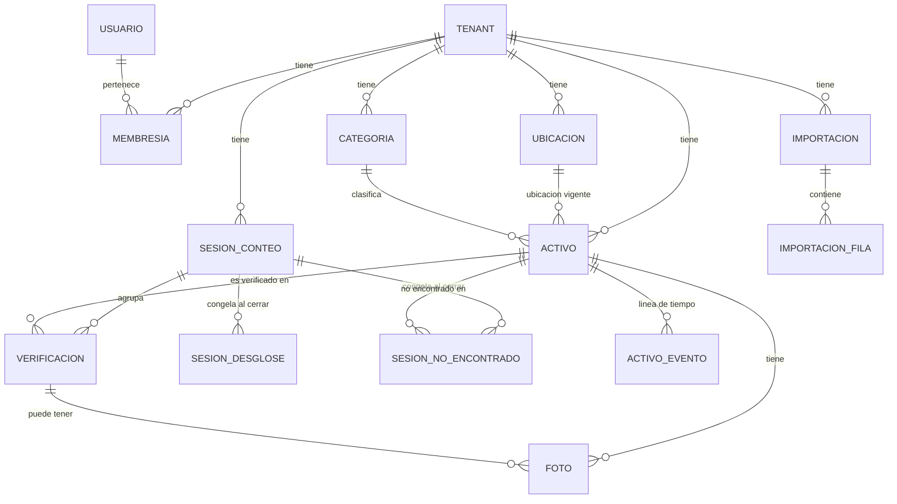

# 03. Modelo de datos

> **Estado: propuesta.** Las marcas `[PENDIENTE]` dependen de preguntas abiertas (ver [05-preguntas-abiertas.md](05-preguntas-abiertas.md)).

## Principios

- PostgreSQL. Todas las tablas de negocio llevan `tenant_id`.
- Claves primarias `uuid`. Las entidades creadas desde el cliente (`verificacion`, `activo` de alta por escaneo, `foto`) usan un UUID generado en el cliente: así reintentar una petición no duplica.
- Dinero siempre `NUMERIC(14,2)`, moneda `COP`. Nunca `float`.
- Nada se borra físicamente: bajas con estado y evento.
- Las verificaciones y los eventos de historial son **inmutables** (solo `INSERT`).
- `seq` es un `bigint` generado por secuencia en el servidor. Sirve para ordenar de forma estable. No se usan timestamps del cliente para ordenar.

## Diagrama

## Entidades

### Identidad y acceso

| Tabla | Campos principales | Notas |
|---|---|---|
| `tenant` | `id`, `nombre`, `creado_en` | Se crea por script/CLI, sin pantalla de alta. |
| `usuario` | `id`, `email` (único), `nombre`, `password_hash`, `activo` | Global, no pertenece a un tenant. |
| `membresia` | `id`, `tenant_id`, `usuario_id`, `rol` (`admin`\|`contador`), `activa` | Único `(tenant_id, usuario_id)`. El token de acceso lleva un solo tenant. |
| `invitacion` | `id`, `tenant_id`, `email`, `rol`, `token_hash`, `expira_en`, `usada_en`, `creada_por` | Enlace de un solo uso. Se guarda `sha256(clave)` con `clave = sha256(token)`, nunca el token. El `email` lo fija quien invita; la aceptación lo toma de la invitación y el invitado no lo escribe. |
| `refresh_token` | `id`, `tenant_id`, `membresia_id`, `familia_id`, `token_hash`, `expira_en`, `usado_en`, `revocado_en`, `creado_en` | Refresh con rotación. Se guarda solo `sha256(clave)` (ver formato abajo). `familia_id` agrupa la cadena de rotación. Único `token_hash`. FK compuesta `(tenant_id, membresia_id)` → `membresia`. El reuso fuera de la ventana de gracia (~10 s) revoca la familia. |
| `limite_tasa` | `ambito`, `clave_hash`, `ventana_inicio`, `intentos` | Tabla de **infraestructura**, no de negocio: contadores de intentos para los límites de tasa (ver nota abajo). PK `(ambito, clave_hash, ventana_inicio)`. **Sin `tenant_id`.** |
| `recuperacion_contrasena` | `id`, `tenant_id`, `usuario_id`, `token_hash`, `expira_en`, `usada_en`, `invalidada_en`, `creado_en` | Enlace de recuperación de un solo uso, 30 minutos (spec 014). Se guarda `sha256(clave)` con `clave = sha256(token)` (mismo formato `bytea(32)` que `invitacion`). FK compuesta `(tenant_id, usuario_id)` → `membresia`. Índice único parcial `(usuario_id) WHERE usada_en IS NULL AND invalidada_en IS NULL` (un enlace vivo por usuario). Sin `GRANT` directo a la aplicación: se opera por `acceso.solicitar_recuperacion` y `acceso.restablecer_contrasena` (ver nota abajo). |

- **`invitacion.email`.** Obligatorio y normalizado: `lower(btrim(email))`.
- **Formato del hash.** `token_hash` es `bytea` de 32 bytes (`CHECK (octet_length(token_hash) = 32)`) en `invitacion` y `refresh_token`. La aplicación calcula `clave = sha256(token)` y la envía a la base en **hex minúsculo de 64 caracteres**; la función hace `sha256(decode(p_clave, 'hex'))` y compara con `token_hash`. Lo que se almacena es, por tanto, `sha256(clave)`, que no sirve como credencial.
- **`invitacion.creada_por`.** `NULL` permitido; `NULL` significa "creada por el operador (script)". La FK `(tenant_id, creada_por)` → `membresia (tenant_id, usuario_id)` usa `MATCH SIMPLE`. Los endpoints de la aplicación solo insertan con `creada_por` no nulo.
- **CHECKs y normalización.** `usuario.email` e `invitacion.email` con `CHECK (email = lower(btrim(email)))` e índice único sobre `usuario.email`; `membresia.rol` e `invitacion.rol` con `CHECK (rol IN ('admin','contador'))`.
- **`usuario` y `tenant`.** No son legibles por el rol de aplicación fuera de la membresía del tenant fijado y no reciben `INSERT`/`UPDATE` de la aplicación; las altas se hacen por funciones del esquema `acceso` y por el script del operador.
- **`limite_tasa`** (spec 002, Q10; migración `0005_limite_tasa`). **Sin `tenant_id`** porque el login, la validación y la aceptación de invitaciones se limitan **antes** de conocer el tenant, y la tabla no guarda datos de negocio ni de la clínica, solo hashes y contadores. Es una excepción cerrada a "toda tabla de negocio lleva `tenant_id`", con prueba propia en el catálogo de RLS (junto con `alembic_version`, `tenant` y `usuario`).
  - Columnas: `ambito` `text` NOT NULL con `CHECK (ambito IN ('login_ip','login_cuenta','refresh_ip','validar_ip','aceptar_ip','recuperar_ip','recuperar_cuenta','restablecer_ip'))` (los tres últimos los añade la spec 014, migración `0015`, reemplazando el `CHECK`); `clave_hash` `bytea` NOT NULL con `CHECK (octet_length(clave_hash) = 32)`, `sha256` de la IP o del email normalizado con la clave derivada de `SECRET_KEY` (nunca IP ni email en claro); `ventana_inicio` `timestamptz` NOT NULL (inicio de la ventana fija); `intentos` `integer` NOT NULL DEFAULT 0 con `CHECK (intentos >= 0)`.
  - Incremento atómico con `INSERT ... ON CONFLICT (ambito, clave_hash, ventana_inicio) DO UPDATE SET intentos = limite_tasa.intentos + 1 RETURNING intentos`, en una transacción propia para que el fallo de la petición no revierta el contador.
  - Ventana de 15 min. Umbrales de referencia, ajustables por configuración: login 5 fallidos por cuenta y 20 por IP; validar y aceptar invitación 10 por IP; refresh 30 por IP; recuperar contraseña 10 por IP (`recuperar_ip`) y 3 por cuenta (`recuperar_cuenta`, sobre el email normalizado); restablecer contraseña 10 por IP (`restablecer_ip`) (spec 014). Respuesta `429` genérica; los emails inexistentes también cuentan, sin oráculo.
  - RLS: `ENABLE` + `FORCE ROW LEVEL SECURITY`, una política por comando (`SELECT`, `INSERT`, `UPDATE`) `TO` el rol de aplicación, sin `PUBLIC` ni `FOR ALL`; la política no filtra por tenant: su defensa es el privilegio mínimo y el hash de la clave. `GRANT SELECT, INSERT, UPDATE (intentos)` al rol de aplicación (el `SELECT` es necesario para el `RETURNING`); `REVOKE` a `anon`/`authenticated`/`service_role`.
  - La aplicación **no tiene `DELETE`**. Las ventanas vencidas se ignoran; la purga es el comando operativo documentado `purgar-limite-tasa`, que ejecuta el operador con el rol migrador, único con `DELETE` y solo sobre esta tabla.
- **`recuperacion_contrasena`** (spec 014; tabla en la migración `0015_recuperacion_contrasena`, funciones en `0016_funciones_recuperacion`). Enlace para fijar una contraseña nueva, enviado por correo. `usuario.password_hash` es global, pero el enlace se liga a la **única** membresía activa del usuario al solicitar para cumplir la regla multi-tenant; con ninguna o más de una membresía activa no se crea.
  - Columnas: `id` `uuid` PK (`gen_random_uuid()`); `tenant_id` `uuid` NOT NULL; `usuario_id` `uuid` NOT NULL; `token_hash` `bytea` NOT NULL, `UNIQUE`, con `CHECK (octet_length(token_hash) = 32)` (mismo formato de hash que arriba); `expira_en` `timestamptz` NOT NULL, `now() + interval '30 minutes'` fijado por la función, con `CHECK (expira_en <= creado_en + interval '30 minutes')`; `usada_en` y `invalidada_en` `timestamptz` NULL con `CHECK (usada_en IS NULL OR invalidada_en IS NULL)`; `creado_en` `timestamptz` NOT NULL DEFAULT `now()`.
  - FK compuesta `(tenant_id, usuario_id)` → `membresia (tenant_id, usuario_id)`. **Índice único parcial** `(usuario_id) WHERE usada_en IS NULL AND invalidada_en IS NULL`: como máximo un enlace pendiente por usuario (parcial porque los NULL no chocan en un `UNIQUE` normal). Pedir un enlace nuevo invalida el pendiente anterior (`invalidada_en`) en la misma transacción.
  - RLS: `ENABLE` + `FORCE ROW LEVEL SECURITY`; `tenant_isolation` `TO` el rol de aplicación (`USING`/`WITH CHECK` con `NULLIF(current_setting('app.tenant_id', true), '')::uuid`), sin `PUBLIC` ni `FOR ALL`. **Ningún `GRANT` al rol de aplicación** (ni `SELECT`): la política existe por catálogo y defensa en profundidad. `REVOKE ALL` a `PUBLIC`, `anon`, `authenticated` y `service_role`.
  - **Nada se borra:** sin `DELETE` para la aplicación ni para `auth_owner` (tampoco un comando de purga). Los enlaces usados, invalidados o vencidos se conservan marcados; el crecimiento lo acotan los límites de tasa y el índice parcial.
  - Funciones del esquema `acceso` (mismo patrón que las de invitaciones: `SECURITY DEFINER`, `STRICT`, `SET search_path = pg_catalog, pg_temp`, dueño `auth_owner`, `EXECUTE` solo para el rol de aplicación; ninguna devuelve token, hash ni datos de otras cuentas):
    - `acceso.solicitar_recuperacion(p_email, p_clave)` → `boolean`: busca el `usuario` activo por email normalizado y cuenta sus membresías activas; si es exactamente una, invalida el pendiente anterior e inserta el enlace nuevo. Ejecuta siempre las mismas sentencias (0 o 1 fila) para no revelar si el correo existe; devuelve `true` solo si insertó.
    - `acceso.restablecer_contrasena(p_clave, p_password_hash)` → `uuid`: en una sola operación atómica consume el enlace (vigente, no usado, no invalidado), comprueba que el usuario sigue activo con exactamente una membresía activa, guarda el `password_hash` nuevo, revoca **todos** los `refresh_token` vivos de todas las membresías del usuario e invalida sus otros enlaces pendientes. Si un paso falla se revierte todo y el enlace queda sin usar. No puede leer `password_hash` (solo `UPDATE` de esa columna).

### Catálogo

| Tabla | Campos principales | Notas |
|---|---|---|
| `ubicacion` | `id`, `tenant_id`, `nombre`, `nombre_clave`, `tipo` (`sede`\|`sala`\|`box`), `padre_id`, `activa`, `creado_en` | Jerarquía estricta por `padre_id`: sede > sala > box (spec 003, Q1). |
| `categoria` | `id`, `tenant_id`, `nombre`, `nombre_clave`, `creado_en` | Lista cerrada. Resuelve "Mobiliaria/Mobiliario/Inmobiliaria" del Excel. |
| `activo` | ver abajo | Entidad central. |

Detalle de `ubicacion` y `categoria` (spec 003, migración `0006`):

- `nombre`: de 1 a 120 caracteres con la regla de nombres visibles (H-3 de la spec 002). `nombre_clave`: el nombre sin tildes, en minúsculas y con espacios colapsados; la calcula la aplicación y la base solo hace cumplir su unicidad.
- `ubicacion`: `CHECK ((tipo = 'sede') = (padre_id IS NULL))`; FK compuesta `(tenant_id, padre_id) → ubicacion (tenant_id, id)`, así el padre es siempre del mismo tenant; el tipo del padre (sala bajo sede, box bajo sala) lo exige la aplicación. Únicos parciales: `(tenant_id, nombre_clave) WHERE padre_id IS NULL` y `(tenant_id, padre_id, nombre_clave) WHERE padre_id IS NOT NULL`. No se borra ni cambia de padre; `activa = false` la saca de los selectores y no se permite con hijas activas (Q2).
- `categoria`: `UNIQUE (tenant_id, nombre_clave)` y `UNIQUE (tenant_id, id)` para las FK compuestas de `activo`.
- Ambas: RLS forzada con `tenant_isolation`; la aplicación no tiene `DELETE` ni actualiza `tenant_id`, `tipo` ni `padre_id`.

`activo`:

| Campo | Tipo | Notas |
|---|---|---|
| `id` | uuid | Generado en cliente si es alta por escaneo. |
| `tenant_id` | uuid | |
| `codigo` | text | **Obligatorio**, único por tenant e **inmutable** tras el alta. Es el código impreso en el sticker de código de barras pegado al activo; el sistema no lo genera. Un duplicado se rechaza. Una fila = una unidad física. |
| `nombre` | text | |
| `categoria_id` | uuid NOT NULL | FK a `categoria`. Categoría **vigente**. |
| `ubicacion_id` | uuid NOT NULL | FK a `ubicacion`. Ubicación **vigente**. Un activo tiene una sola. |
| `serial`, `marca`, `modelo`, `referencia`, `color` | text null | `serial` es el del fabricante, **opcional y no único**: el Excel repite seriales en distintas ubicaciones y es válido. Solo índice; nunca se usa para fusionar ni deduplicar. |
| `subtipo` | text null | Ej. Video, Computador, Fuente. Texto libre con autocompletado; la categoría es la lista cerrada. |
| `atributos` | jsonb | Campos propios de una categoría (ej. `lote`, `registro_sanitario` en biomédicos). |
| `precio_compra` | numeric(14,2) NOT NULL | Precio de compra, según el alcance. **Obligatorio en el alta** (P13, 2026-11-11). **Visibilidad:** solo el `admin` lo ve; el `contador` lo escribe al dar de alta y la API no se lo devuelve después. Lo mismo aplica a `precio_al_contar` y a los eventos `precio_cambiado`. El filtrado es del servidor. |
| `fecha_compra` | date null | Propuesto, ver pregunta P7. |
| `estado` | enum | `activo`, `en_reparacion`, `dado_de_baja`. |
| `row_version` | int | Concurrencia optimista en ediciones **online** (`If-Match`). |
| `creado_por`, `creado_en`, `actualizado_en` | | |

Detalle de `activo` y `activo_evento` (spec 004, migración `0007`):

- `codigo`: `CHECK (codigo ~ '^[A-Z0-9._/-]{1,40}$')` (Q1 de la 004: la aplicación lo pasa a mayúsculas) y `UNIQUE (tenant_id, codigo)`. `precio_compra >= 0` (Q2 de la 004). `nombre` y los opcionales de texto de 1 a 120 caracteres.
- FK compuestas `(tenant_id, categoria_id)`, `(tenant_id, ubicacion_id)` y `(tenant_id, creado_por) → membresia (tenant_id, usuario_id)`: todo del mismo tenant.
- **Solo sala o box (D1 de la 004):** el disparador `activo_ubicacion_valida` (`SECURITY INVOKER`, `search_path` fijo) rechaza al insertar o cambiar `ubicacion_id` una sede o una ubicación inactiva. Una ubicación con activos `activo` o `en_reparacion` no se desactiva (D2 de la 004, `409 tiene_activos`).
- `activo_evento` es inmutable: la aplicación solo tiene `SELECT` e `INSERT`; `seq` es una identidad. `sesion_id` y `verificacion_id` no tienen FK hasta la spec 006.
- `UPDATE` de `activo` (spec 005, migración `0008`): solo las columnas editables (nombre, categoría, ubicación, serial, marca, modelo, subtipo, precio, fecha de compra) más `estado`, `row_version` y `actualizado_en`. Nunca `codigo`, `id`, `tenant_id`, `creado_por`, `creado_en`, `atributos`, `referencia` ni `color` (la API no los expone). Cada cambio sube `row_version` una vez y se escribe con `If-Match` (`412` si la versión no coincide); guardar sin cambios no toca la fila ni escribe eventos.
- Un activo `dado_de_baja` es de solo lectura; solo se reactiva (vuelve a `activo`) con motivo (Q1 de la 005).

Se eliminó el campo `requiere_revision` (decisión del humano, 2026-11-11): no tiene uso, porque el alta no se revisa (P11) y el precio es obligatorio (P13), y aún no existen migraciones.

### Conteo e historial

`sesion_conteo`:

| Campo | Notas |
|---|---|
| `id`, `tenant_id`, `nombre` | |
| `tipo` | `conteo` \| `importacion`. La importación crea una sesión baseline que **no** cuenta como conteo real. |
| `estado` | `abierta` \| `cerrada`. Una vez `cerrada` no se modifica nada asociado. |
| `abierta_por`, `abierta_en`, `cerrada_por`, `cerrada_en` | |
| `fecha_corte` | Fecha a la que se refiere el informe. |
| `total_encontrado`, `total_no_encontrado`, `total_registrado` | numeric(14,2). **Se congelan al cerrar.** Son la suma de las filas del desglose de una dimensión (regla R4). El desglose por categoría y por ubicación se congela en `sesion_desglose` (R9) y la lista por activo de los no encontrados en `sesion_no_encontrado` (R9a). |

`sesion_desglose` (**propuesta**, decisión del humano del 2026-11-11; inmutable, solo `INSERT`; la escribe solo el servidor en la misma transacción del cierre):

| Campo | Tipo | Notas |
|---|---|---|
| `id` | uuid | Lo genera el servidor (no hay escritura desde el cliente). |
| `tenant_id` | uuid | Como toda tabla de negocio (R1). |
| `sesion_id` | uuid | Sesión `cerrada` a la que pertenece. |
| `dimension` | enum | `categoria` \| `ubicacion`. |
| `categoria_id` | uuid null | FK a `categoria`. Lleno si `dimension=categoria`; nulo en otro caso. Qué categoría se usa: la del criterio de R4 (P21, decidida el 2026-11-11). |
| `ubicacion_id` | uuid null | FK a `ubicacion`. Lleno si `dimension=ubicacion`; nulo en otro caso. Es exactamente la ubicación del criterio de R4 (el nodo de la jerarquía al que apunta el activo o la verificación) (P20, decidida el 2026-11-11); no se agrega por sede ni por sala. |
| `total_encontrado`, `total_no_encontrado`, `total_registrado` | numeric(14,2) | COP. Suma de los precios de los activos de U (R4) que caen en la fila. |
| `unidades_encontrado`, `unidades_no_encontrado`, `unidades_registrado` | integer | Una unidad = un `activo` (R8). |
| `creado_en` | timestamptz | Igual a `cerrada_en` de la sesión. |

Restricciones propuestas:

- Índice único parcial `(sesion_id, categoria_id) WHERE dimension = 'categoria'`.
- Índice único parcial `(sesion_id, ubicacion_id) WHERE dimension = 'ubicacion'`.
- `CHECK`: si `dimension = 'categoria'`, `categoria_id IS NOT NULL AND ubicacion_id IS NULL`; si `dimension = 'ubicacion'`, `ubicacion_id IS NOT NULL AND categoria_id IS NULL`.
- Motivo: en PostgreSQL los `NULL` son distintos entre sí, así que un único `(sesion_id, dimension, categoria_id, ubicacion_id)` no detectaría filas duplicadas.

Solo hay fila para categorías y ubicaciones con al menos un activo del universo de cierre U (R4). Los subtotales por jerarquía (sede, sala) son una vista que suma filas de ubicación; no se guardan. `sesion_conteo` no tiene columnas de unidades: las unidades totales de la sesión se leen como la suma de una dimensión del desglose, que también está congelada. Un nombre de categoría o ubicación cambiado después no altera las cifras; el rótulo que se muestra es el vigente `[PENDIENTE: si hace falta congelar también el nombre, se decide en la spec 008]`.

`sesion_no_encontrado` (**propuesta**, decisión del humano E1 del 2026-11-11; inmutable, solo `INSERT`; la escribe solo el servidor en la misma función y transacción del cierre, R4, R8 y R9a):

| Campo | Tipo | Notas |
|---|---|---|
| `id` | uuid | Lo genera el servidor (no hay escritura desde el cliente). |
| `tenant_id` | uuid NOT NULL | Como toda tabla de negocio (R1). |
| `sesion_id` | uuid NOT NULL | FK a `sesion_conteo`. Sesión `cerrada` a la que pertenece. |
| `activo_id` | uuid NOT NULL | FK a `activo`. Activo de U sin verificación en la sesión (no encontrado, R4). |
| `codigo` | text NOT NULL | Copia de `activo.codigo` al cierre. |
| `nombre` | text NOT NULL | Copia de `activo.nombre` al cierre. Un cambio de nombre posterior no altera la lista. |
| `categoria_id` | uuid NOT NULL | FK a `categoria`. `activo.categoria_id` vigente al cierre (criterio de R4, D1/P21). |
| `ubicacion_id` | uuid NOT NULL | FK a `ubicacion`. `activo.ubicacion_id` vigente al cierre (criterio de R4, D1/P20). |
| `precio` | numeric(14,2) NOT NULL | COP. `activo.precio_compra` vigente al cierre. Solo lo ve el `admin` (P13). |
| `en_reparacion` | boolean NOT NULL | `true` si el activo tenía estado `en_reparacion` al cierre. Es la marca "en reparación" que muestran el informe, la exportación y el Inicio. |
| `creado_en` | timestamptz | Igual a `cerrada_en` de la sesión. |

Restricciones propuestas:

- Índice único `(sesion_id, activo_id)`: un activo aparece como mucho una vez por sesión.
- Solo hay filas de sesiones `cerrada` de tipo `conteo`.

Detalle de `sesion_conteo` y `verificacion` (spec 006, migración `0009`):

- Una sola sesión `conteo` `abierta` por tenant (índice único parcial; Q1 de la 006, cierra P12). `CHECK ((estado = 'cerrada') = (cerrada_en IS NOT NULL))`. La aplicación inserta solo `tenant_id`, `nombre`, `fecha_corte` y `abierta_por` (siempre `conteo` y `abierta`) y aún no tiene `UPDATE`: el cierre, con los totales, llega con la 008.
- `verificacion` es inmutable (solo `INSERT` y `SELECT`); `seq` es una identidad y `recibido_en` lo pone la base. FK compuestas a sesión, activo, las dos ubicaciones, categoría y membresía del autor. `nota` de 1 a 120. `estado_fisico` `ok` o `danado` (Q2 de la 006).
- `activo_evento.sesion_id` y `verificacion_id` tienen FK compuesta desde la `0009`.
- Un reintento con el `id` de una verificación ya guardada la devuelve aunque la sesión se haya cerrado después (Q3 de la 006: R2 precede a R5 solo en ese caso).

Cierre (spec 008, migración `0011`): `sesion_conteo` gana `total_encontrado`, `total_no_encontrado` y `total_registrado` (`numeric(14,2)`), obligatorios si y solo si está `cerrada`, `>= 0` y registrado = encontrado + no encontrado. La aplicación tiene `UPDATE` solo de las columnas del cierre y el disparador `sesion_conteo_inmutable` permite únicamente la transición `abierta → cerrada`: una sesión cerrada no se modifica ni se reabre (R5, también para el dueño de la tabla). `sesion_desglose` y `sesion_no_encontrado` son solo `INSERT`/`SELECT`, el disparador `conteo_cerrado_requerido` exige la sesión ya cerrada al insertar, y congelan la etiqueta (nombre de la categoría o ruta de la ubicación) al cierre (Q3 de la 008: el informe se lee igual aunque luego se renombre). El cierre toma el candado consultivo **exclusivo** de la sesión (la verificación toma el compartido, 006) y la fila con `FOR UPDATE`; U se lee en una sola consulta. Cerrar una sesión ya cerrada devuelve su informe sin reinsertar (Q1 de la 008).

Supabase (spec 010b, migración `0012`, C8): las tres funciones de disparador de `public` tampoco son ejecutables por `anon`, `authenticated` ni `service_role` (Supabase les concede por defecto lo que crea `postgres`); con eso esos roles no reciben ningún privilegio sobre tablas ni funciones. En una base sin esos roles no hace nada.

`verificacion` (inmutable, unidad de sincronización):

| Campo | Notas |
|---|---|
| `id` | UUID del cliente. Es la clave de idempotencia. |
| `tenant_id`, `sesion_id`, `activo_id` | |
| `ubicacion_esperada_id` | uuid NOT NULL, FK a `ubicacion`. La que tenía el activo al contar (copia de `activo.ubicacion_id`). Es la que usa el desglose por ubicación para lo encontrado (R4, P20). |
| `ubicacion_encontrada_id` | Donde se vio realmente. Si difiere, es una **observación**, no un cambio. |
| `estado_fisico` | `ok` \| `danado` (lista corta, `[PENDIENTE]` con la clínica). |
| `precio_al_contar` | numeric(14,2) NOT NULL. **Copia** de `activo.precio_compra` vigente al contar. Hace reproducible el informe. |
| `categoria_al_contar` | uuid NOT NULL, FK a `categoria` (el id, no el nombre). **Copia** de `activo.categoria_id` vigente al contar. |
| `nota` | |
| `verificado_por` | |
| `ocurrido_en` | Reloj del cliente, solo informativo. |
| `recibido_en`, `seq` | Los pone el servidor. |

`activo_evento` (línea de tiempo, la escribe solo el servidor):

| Campo | Notas |
|---|---|
| `id`, `tenant_id`, `activo_id` | |
| `tipo` | `creado`, `importado`, `verificado`, `ubicacion_cambiada`, `precio_cambiado`, `estado_cambiado`, `categoria_cambiada`, `datos_cambiados` (Q3 de la 005), `dado_de_baja`, `discrepancia_descartada` (Q2 de la 007), `foto_agregada`, `foto_cambiada`, `foto_retirada` (spec 012). |
| `datos` (jsonb) | `{antes, despues}` para cambios (detalle por tipo abajo). |
| `usuario_id`, `sesion_id` null, `verificacion_id` null | |
| `ocurrido_en`, `seq` | |

Contenido de `datos` por tipo (spec 005): `precio_cambiado` `{antes, despues}` en texto canónico; `categoria_cambiada` `{antes: {id, nombre}, despues: {id, nombre}}`; `datos_cambiados` `{campos: {<campo>: {antes, despues}}}` (nombre, serial, marca, modelo, subtipo, fecha de compra); `ubicacion_cambiada` `{antes: {id, ruta}, despues: {id, ruta}}` (la ruta se copia: el historial no cambia si se renombra la sala); `estado_cambiado` `{antes, despues}` y, al reactivar, `motivo` (`encontrado`, `baja_por_error`, `otro`) y `nota`; `dado_de_baja` `{motivo, nota?}` con motivo `danado_sin_reparacion`, `perdido`, `vendido_o_donado`, `obsoleto` u `otro` (nota obligatoria con `otro`, Q2 de la 005). Discrepancias (spec 007, migración `0010`): aplicar escribe `ubicacion_cambiada` con `sesion_id`, `verificacion_id` y `datos` `{antes, despues, origen: 'discrepancia', sesion}`; descartar escribe `discrepancia_descartada` con `{esperada, encontrada, sesion}`. Un índice único parcial `(tenant_id, verificacion_id)` sobre esos dos tipos garantiza **una sola resolución por verificación**; la verificación y la sesión no se modifican (Q1 de la 007: también en sesiones cerradas). Al `contador` el servidor le omite `precio_cambiado` y le quita todo precio de los demás eventos (P13).

`foto` (spec 012, migración `0013_fotos`): `id` (UUID del cliente: subir otra vez con el mismo `id` no duplica), `tenant_id`, `activo_id`, `verificacion_id` null (foto opcional al contar), `clave` (la arma el servidor: `<tenant>/<foto>.jpg`, más `<tenant>/<foto>_mini.jpg`), `bytes`, `ancho`, `alto`, `subida_por`, `creada_en`, `retirada_en` y `retirada_por` (juntos o ninguno). La fila se escribe **después** de guardar la imagen (no hay estado «pendiente»). Únicos parciales: una principal vigente por activo `(tenant_id, activo_id) WHERE verificacion_id IS NULL AND retirada_en IS NULL` y una foto por verificación `(tenant_id, verificacion_id) WHERE verificacion_id IS NOT NULL`. El rol de la app: `SELECT`, `INSERT` y `UPDATE (retirada_en, retirada_por)`; sin `DELETE`; el disparador `foto_retirada_es_final` impide tocar una foto retirada (`P0005`). Cambiar o quitar la principal la marca retirada y **borra su imagen** del almacenamiento (Q2 B de la 012); el historial guarda `foto_agregada` `{foto_id}`, `foto_cambiada` `{antes, despues}` y `foto_retirada` `{foto_id}`. Las imágenes viven en almacenamiento de objetos (carpeta local en desarrollo, Supabase Storage en producción), no en la base, y solo Flask las entrega.

Empresa e informe con su identidad (spec 013, migración `0014_empresa_y_detalle`):

- `empresa`: una fila por tenant (`tenant_id` es la clave primaria): `nombre` (1–120), `direccion` (1–200), `nit` null (formato `900.123.456-7`; el dígito de verificación lo valida la aplicación), `telefono` null (7–30), `correo` null, `logo_id` null → `empresa_logo`, `actualizada_en`, `actualizada_por`. El rol de la app: `SELECT`, `INSERT` y `UPDATE` de esas columnas, sin `DELETE`; solo el admin la escribe (aplicación).
- `empresa_logo`: `id` (del cliente), `clave` (`<tenant>/<logo>.png`), `bytes`, `ancho`, `alto`, `subido_por`, `creado_en`. Solo `INSERT`/`SELECT`: **nunca se borra**, porque los informes congelados lo siguen usando.
- `sesion_empresa`: copia de los datos de la empresa al cerrar (R3 de la 013), clave `(tenant_id, sesion_id)`, más `vigente` (siempre `false` al cerrar; para sesiones anteriores a la 013 el informe usa la empresa vigente y la rotula, Q1 A).
- `sesion_detalle`: **una fila por activo del universo U del cierre** (R4 de la 013), con los mismos criterios que el desglose: `codigo`, `nombre`, `marca`, `serial`, `categoria_id`/`categoria_nombre`, `ubicacion_id`/`ubicacion_ruta` (esperada), `encontrada_ruta` y `estado_fisico` (solo encontrados), `encontrado`, `en_reparacion` y `precio`. Único `(tenant_id, sesion_id, activo_id)`; `encontrado` ⇔ estado y ubicación encontrada. Sumado por categoría o por ubicación es **igual** al desglose (R8: lo escribe `cerrar` desde la misma lista U).
- `sesion_empresa` y `sesion_detalle` son solo `INSERT`/`SELECT` y solo aceptan sesiones cerradas (disparador `conteo_cerrado_requerido`).

### Importación (opcional)

- `importacion`: `id`, `tenant_id`, `archivo_nombre`, `estado` (`en_revision`\|`confirmada`\|`cancelada`), `creada_por`.
- `importacion_fila`: `id`, `importacion_id`, `hoja`, `fila`, `datos` (jsonb crudo), `resultado` (`nueva`\|`duplicado_probable`\|`dudosa`\|`descartada`), `motivo`, `decision` (`importar`\|`omitir`\|`fusionar`), `activo_id`.

Las filas crudas se conservan: son la evidencia de qué se importó y por qué.

## Reglas e invariantes

- **R1. Aislamiento.** Toda consulta se filtra por `tenant_id` en un único punto de la capa de datos.
- **R2. Idempotencia.** Reenviar una `verificacion` o un alta por escaneo con el mismo `id` no duplica ni falla: devuelve el registro ya guardado.
- **R3. Última verificación gana.** Para el informe, se usa una verificación por `(sesion, activo)`: la de mayor `seq`. Las demás se conservan en el historial.
- **R4. Cierre.** Cerrar una sesión calcula y guarda los tres totales a partir de las verificaciones R3 y de `precio_al_contar` (decisiones del humano del 2026-11-11: P15, P20, P21 y activos dados de baja).
  - **Universo del cierre U** = {activos con verificación R3 en la sesión, cualquiera sea su estado al cierre} ∪ {activos con estado `activo` o `en_reparacion` al cierre y sin verificación en la sesión}. Los `dado_de_baja` sin verificación en la sesión quedan fuera. Cada activo de U cae en exactamente una fila por dimensión del desglose (R9).
  - **Encontrado** (activo de U con verificación R3): precio = `precio_al_contar`, categoría = `categoria_al_contar` y ubicación = `ubicacion_esperada_id`, todos de esa verificación (foto al contar, ADR-003). Si después se dio de baja en la misma sesión, sigue siendo encontrado.
  - **No encontrado** (activo de U sin verificación): precio = `activo.precio_compra`, categoría = `activo.categoria_id` y ubicación = `activo.ubicacion_id`, vigentes al cierre. Un activo `en_reparacion` sin verificación va aquí, y el informe muestra la marca "en reparación" para no confundirlo con un faltante. La marca se congela al cierre en `sesion_no_encontrado.en_reparacion`, junto con la lista por activo de los no encontrados (R9a, decisión E1 del 2026-11-11).
  - Una discrepancia aplicada o un movimiento durante la sesión abierta no mueve lo ya contado: lo encontrado se ubica por `ubicacion_esperada_id` de su verificación. Lo mismo vale para un cambio de precio o de categoría posterior a la verificación.
  - **Un solo cálculo (R8).** Una sola función de dominio del servidor calcula **una vez** la lista de activos de U con su condición (encontrado / no encontrado), precio, categoría y ubicación según los puntos anteriores. De esa lista salen las filas del desglose (R9) y las filas de la lista de no encontrados (R9a), y `total_encontrado`, `total_no_encontrado` y `total_registrado` de `sesion_conteo` son la suma de esas filas (`total_registrado` = encontrado + no encontrado). Ningún otro código vuelve a calcular U ni los totales.
  - **Vista consistente y concurrencia.** El cierre bloquea la fila de `sesion_conteo` y lee U con una vista consistente de los datos (por ejemplo, aislamiento `REPEATABLE READ` o una sola consulta). Cubre toda escritura concurrente que pueda cambiar U o sus valores, no solo las verificaciones: alta de un activo, cambio de precio, de categoría o de ubicación, cambio de estado y baja. Cada una queda entera dentro de la vista del cierre o entera fuera; nunca a medias. Una verificación que llega después del cierre recibe `409 sesion_cerrada` (R5). El mecanismo exacto lo fija la spec 008; la regla es esta.
  - En la misma transacción guarda el desglose congelado (R9) y la lista congelada de no encontrados (R9a). Cierre repetido de una sesión ya cerrada: `[PENDIENTE]` (¿devuelve el informe o `409`?); en ningún caso se vuelven a insertar el desglose ni la lista.
- **R5. Sesión cerrada es inmutable.** Una verificación que llega para una sesión cerrada se rechaza con motivo `sesion_cerrada`.
- **R5a. Activo dado de baja no se verifica** (decisión del humano, 2026-11-11). El servidor rechaza una verificación de un activo con estado `dado_de_baja`; la app lo muestra como dado de baja. Una verificación guardada antes de la baja se conserva y, en esa sesión, el activo cuenta como encontrado (R4).
- **R6. Discrepancias.** Verificación con `ubicacion_encontrada_id ≠ ubicacion_esperada_id` aparece en la lista de discrepancias; el admin la aplica y eso genera `ubicacion_cambiada`.
- **R7. Valor en tiempo real.** Es una consulta sobre `activo` vigente, distinta del informe de sesión. No se mezclan. Cuentan los activos con estado `activo` o `en_reparacion`; los `dado_de_baja` no (P15, decisión E2 del 2026-11-11; mismo criterio de estado que la parte sin verificación del universo del cierre, R4). Aplica al valor en tiempo real, a "Activos hoy", a la tarjeta "Valor actual" y a las gráficas de "valor actual" del Inicio. El Inicio puede mostrar aparte cuántos de ellos están `en_reparacion`.
- **R8. Una fila por unidad y código del sticker.** No existe `cantidad` ni lote. Todo total es la suma de precios por unidad, calculada en un solo lugar del servidor. El `codigo` (el del sticker) es obligatorio, único por tenant e inmutable; no hay activos sin sticker.
- **R9. Desglose congelado al cierre** (decisión del humano, 2026-11-11). En la misma transacción del cierre (R4) el servidor inserta en `sesion_desglose` una fila por categoría y una por ubicación, con encontrado, no encontrado y total registrado en COP y en unidades. Las filas salen de la misma lista de activos de U que calcula R4 (mismo universo, mismos precios, misma categoría y misma ubicación por activo); R9 no tiene un cálculo propio. Motivo: lo "no encontrado" no tiene verificación que congele su precio, categoría ni ubicación; recalcularlo después cambiaría el informe si se corrige un precio o una categoría, se mueve o se da de baja un activo (rompería ADR-003). Reglas:
  - Las filas son inmutables (solo `INSERT`) y llevan `tenant_id`.
  - Cada activo de U (R4) cae en exactamente una fila de cada dimensión: la de su categoría y la de su ubicación según el criterio de R4 (encontrado: `categoria_al_contar` y `ubicacion_esperada_id` de su verificación R3; no encontrado: `activo.categoria_id` y `activo.ubicacion_id` vigentes al cierre).
  - La fila de ubicación usa exactamente esa ubicación, sin agregar por sede ni por sala. Los subtotales por jerarquía son una vista que suma filas; no se guardan.
  - Para cada dimensión, la suma de `total_encontrado`, `total_no_encontrado` y `total_registrado` de sus filas es igual a las tres cifras congeladas de la sesión, con cero diferencias; las unidades suman lo mismo en las dos dimensiones. Una prueba lo verifica.
  - El informe de sesión, su exportación y la evolución entre conteos **leen** estas filas; no recalculan el desglose.
  - Solo hay desglose de sesiones `cerrada` de tipo `conteo`; la sesión `importacion` no entra en la evolución.
  - P20 y P21 decididas (2026-11-11, ver [05, sección D](05-preguntas-abiertas.md#d-preguntas-surgidas-de-los-casos-de-uso)): criterio simétrico. Lo encontrado usa la foto al contar de su verificación R3 (`categoria_al_contar`, `ubicacion_esperada_id`), igual que el precio (ADR-003); lo no encontrado usa `activo.categoria_id` y `activo.ubicacion_id` vigentes al cierre. La ubicación encontrada no se usa en el desglose (no existe para lo no encontrado).
- **R9a. Lista de no encontrados congelada al cierre** (decisión del humano E1, 2026-11-11). En la misma función de dominio y la misma transacción del cierre (R4, R8), el servidor inserta en `sesion_no_encontrado` una fila por cada activo no encontrado de U, a partir de la misma lista U que usa R9: mismo precio (`activo.precio_compra` vigente al cierre), misma categoría y misma ubicación (vigentes al cierre, D1), más `codigo`, `nombre` y la marca `en_reparacion` copiados al cierre. R9a no tiene un cálculo propio. Motivo: lo no encontrado no tiene verificación que congele qué activos eran ni su estado; reconstruir la lista o la marca después cambiaría el informe si un activo se repara, se edita, se mueve o se da de baja (rompería ADR-003). Reglas:
  - Las filas son inmutables (solo `INSERT`), llevan `tenant_id` y son únicas por `(sesion_id, activo_id)`.
  - Cuadre (pruebas obligatorias, cero diferencias): la suma de `precio` de la lista = `total_no_encontrado` de la sesión; el número de filas = las unidades no encontradas; por cada categoría y por cada ubicación, la suma de `precio` y el número de filas de la lista coinciden con `total_no_encontrado` y `unidades_no_encontrado` de la fila correspondiente de `sesion_desglose`.
  - El informe de sesión, su exportación y el Inicio **leen** la lista y la marca "en reparación" de esta tabla; nada se reconstruye después a partir de `activo`.
  - Visibilidad (P13): la lista contiene precios; solo el `admin` la ve y el filtrado es del servidor.
